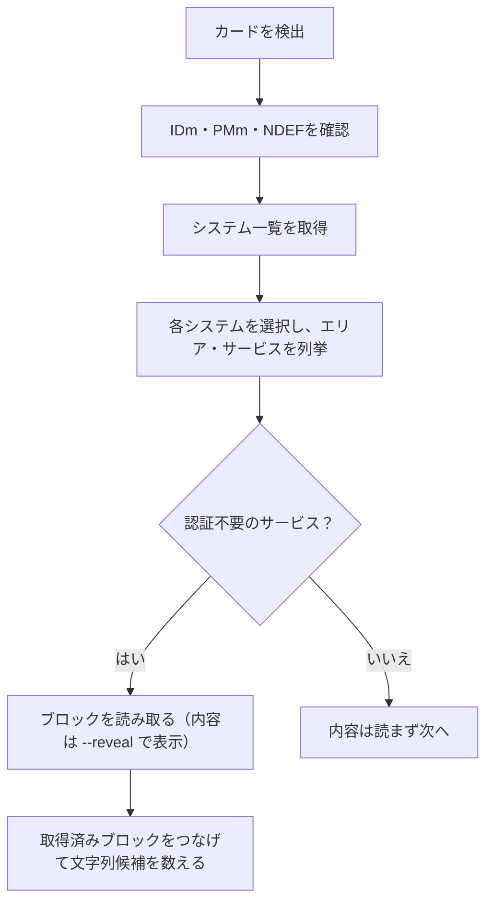
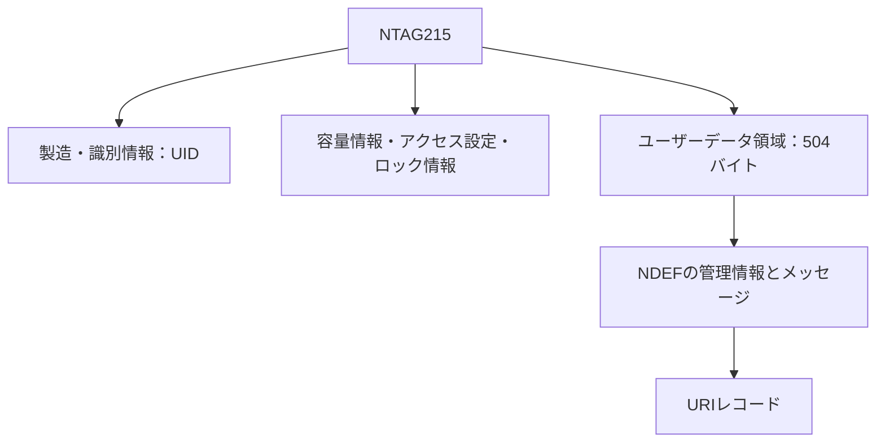
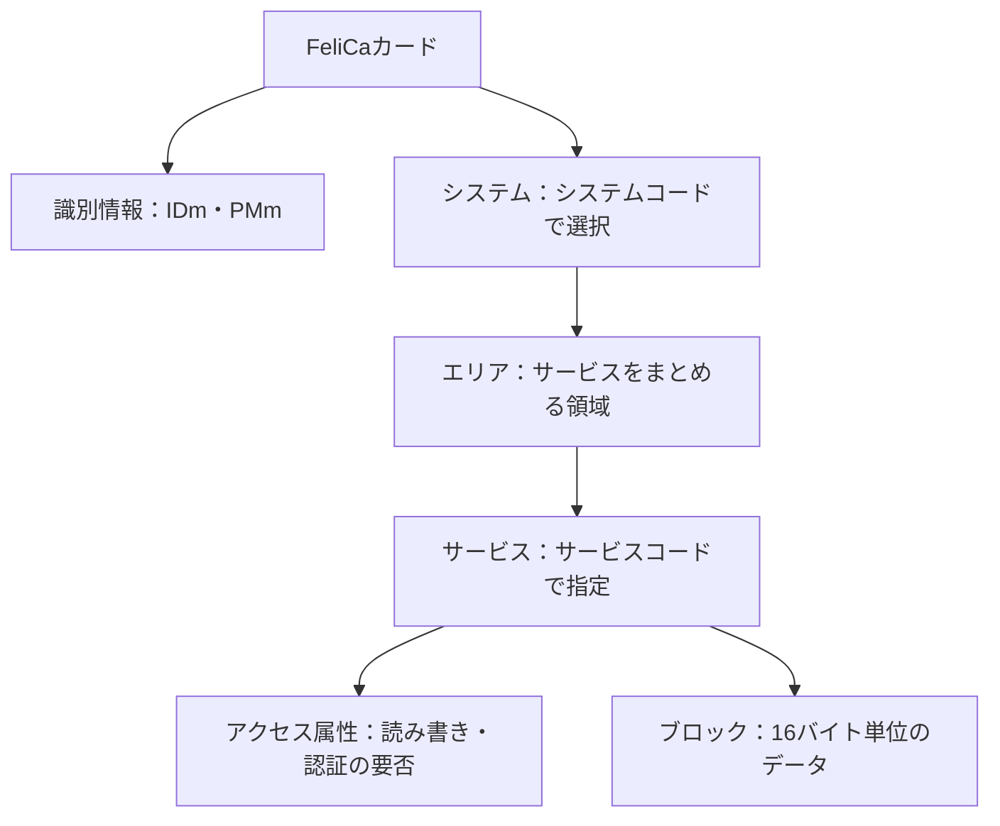

# demo-NFC

USB 接続の NFC リーダー（RC-S380 など）と Python の [nfcpy](https://nfcpy.readthedocs.io/) で、手元の NFC カードを **読み取り専用** で調べる検証用リポジトリです。ソニーの有料 SDK は使いません。

- カードの種類、識別番号（UID / IDm）、NDEF の有無、FeliCa のシステム・サービスの数を表示します。
- FeliCa カードでは、システム・エリア・サービスを列挙し、**認証不要のサービスだけ**ブロックを読みます。
- 書き込みも、鍵が必要な領域へのアクセスも行いません。
- 識別番号・コード・カード内のデータは、**既定で伏せ字**です。`--reveal` を付けたときだけ全て表示します。

自分が所有するカード、または読み取りの許可を得たカードだけで試してください（[プライバシーの扱い](#プライバシーの扱い)）。

## 検証環境

| 項目 | 内容 |
| --- | --- |
| PC | M2 MacBook Air（macOS 26.6.2） |
| リーダー | SONY RC-S380/S（USB 認識名 `RC-S380/S`、`usb:054c:06c1`） |
| Python | 3.14.0 |
| パッケージ管理 | uv 0.9.7 |
| NFC ライブラリ | nfcpy 1.0.4（USB 通信は libusb1 経由） |
| 読み取り対象 | NTAG215、FeliCa カード |

動作を確認できたのは上の組み合わせだけです。nfcpy のドキュメントでは macOS が定期テスト環境に含まれていません。

## 対応リーダー

nfcpy 1.0.4 のドライバ定義（`nfc/clf/device.py`）に載っている USB リーダーです。

| リーダー | `--device` 指定 | 確認状況 |
| --- | --- | --- |
| Sony RC-S380/S | `usb:054c:06c1` | **実機で確認**（`main.py` の既定値） |
| Sony RC-S380/P | `usb:054c:06c3` | 未確認（nfcpy の対応表のみ） |
| Sony RC-S330 / S360 / S370 | `usb:054c:02e1` | 未確認 |
| ACS ACR122U | `usb:072f:2200` | 未確認 |
| Identiv SCL3711 / SCL3712 | `usb:04e6:5591` / `usb:04e6:5593` | 未確認 |
| PN532 搭載ボード（シリアル） | `tty:USB0:pn532` | 未確認 |
| 最初に見つかった USB リーダー | `usb` | リーダーを 1 台だけ挿す場合 |

### 手元のリーダーの指定を調べる（macOS）

箱の表記と USB の認識名が違うことがあります（箱は「RC-S380」、認識名は「RC-S380/S」など）。
Vendor ID と Product ID を確認して、上の表と照らし合わせてください。

```bash
ioreg -p IOUSB -l -w 0 | grep -A 24 'RC-S380'
```

`idVendor` と `idProduct` は 10 進数で表示されます。16 進数にして `usb:` を付けたものが `--device` の値です。

```bash
printf 'usb:%04x:%04x\n' 1356 1729   # → usb:054c:06c1
```

## セットアップ

必要なもの: [uv](https://docs.astral.sh/uv/)、Python 3.14、対応リーダー。

```bash
brew install uv libusb   # macOS。libusb 本体は nfcpy とは別に必要
uv sync
uv run python -m nfc     # nfcpy の導入とリーダーの認識を確認
```

`libusb1`（Python 側の橋渡し）は nfcpy の依存として入りますが、libusb 本体は含まれません。
Linux では libusb と USB のアクセス権限（udev ルール）が必要です。

## 使い方

```bash
uv run python main.py
uv run python main.py --device usb:054c:06c3 --timeout 60 --max-blocks 64
```

待機メッセージが出たらカードをリーダー中央に置きます。1 枚読んだら終了します。

| オプション | 既定 | 内容 |
| --- | --- | --- |
| `--device` | `usb:054c:06c1` | nfcpy のデバイス指定 |
| `--timeout` | 180 | カード待機秒数 |
| `--max-blocks` | 32 | 1 サービスあたりの最大ブロック数（最大 65536） |
| `--reveal` | 無効 | ID・コード・カード内のデータを伏せずに表示（自分のカードの確認用） |

無制限に探索しないよう、次の上限があります。

| 対象 | 上限 |
| --- | --- |
| FeliCa のシステム・サービス調査 | 約 30 秒（コマンド間で確認） |
| エリア・サービスの探索 | 1 システムあたり 256 件 |
| ブロック読み取り | `--max-blocks` |

終了コードは、正常 0、カードを取得できなかった・エラー 1、Ctrl+C 130 です。

### 処理の流れ



### 出力例

既定（伏せ字）。値は説明用の架空のものです。

NTAG215（NDEF に URL を記録したタグ）:

```text
カード種類: Type2Tag
製品名: NXP NTAG215
UID: **************  (7バイト)
NDEF: 16バイト
  レコード1: urn:nfc:wkt:U（内容は非表示）
```

FeliCa カード:

```text
カード種類: Type3Tag
IDm: 0123************  (8バイト)
PMm: ****************  (8バイト)
NDEF: 取得できませんでした（他形式のデータがある場合もあります）。
システム数: 2（コードは非表示）
エリア数: 1、サービス数: 2
認証不要のサービス数: 1
読み取れたブロック数: 4
ASCII文字列候補: 1件（内容は非表示）
```

`--reveal` を付けると、タグの詳細、ID・PMm、システムコード、エリア・サービスのコード、ブロックの内容、文字列候補を全て表示します。
出力の形だけを示す架空の例です。

```text
システムコード: XXXX, YYYY

システム XXXX
  Service Code ...
    [0000] 41 42 43 44 45 46 47 48 00 00 00 00 00 00 00 00 | ABCDEFGH........
    ASCII候補（バイト位置0）: 'ABCDEFGH'
```

認証が必要なサービスは、内容を読みません（`--reveal` では「読み取り対象外です」と表示します）。

## 読み取れるものと、読み取らないもの

| 対象 | このリポジトリの範囲 |
| --- | --- |
| UID / IDm / PMm | 取得して伏せ字で表示（`--reveal` で全桁） |
| NDEF（URL・テキスト等） | 取得。既定ではレコード種別だけ表示（`--reveal` で内容） |
| FeliCa のシステム・エリア・サービス | 列挙して数だけ表示（`--reveal` でコード） |
| FeliCa の認証不要サービスのブロック | 読み取って件数だけ表示（`--reveal` で内容） |
| 認証が必要な領域 | 読まない |
| 駅名・残高・利用履歴の意味 | 解釈しない（バイト列を表示するだけ） |

通信できることと、データの意味が分かることは別です。
PASMO の履歴表示には、交通系のデータ形式を解釈する処理が必要です。
`--reveal` で表示されるのは、バイト列と ASCII として読める文字列候補だけです。

## データの読み方

### UID と IDm

| 名前 | 対象 | 意味 |
| --- | --- | --- |
| UID | NTAG などの Type 2 / Type 4 | IC の識別番号。通常の書き込みでは変わらない |
| IDm | FeliCa（Type 3） | カードの識別番号。システムごとに異なる場合がある |
| PMm | FeliCa | 製造パラメーター情報 |

どれも氏名などの個人情報そのものではありませんが、カードを区別する手掛かりになります。公開するときは伏せてください。

### NDEF と UID は別の情報

NTAG215 のユーザーデータ領域は 504 バイトで、4 バイト単位の「ページ」で扱います。
NDEF は、URL やテキストを「種類」と「内容」のレコードにまとめる共通形式です。
管理情報にも容量を使うため、504 バイトすべてを URL に使えるわけではありません。



### FeliCa のシステム・エリア・サービス・ブロック

FeliCa は NTAG とは別の方式で、ファイルシステムに似た構造を持ちます（同じものではありません）。
交通系 IC など、多くの IC カードがこの方式です。



| 比較 | NTAG215 | FeliCa |
| --- | --- | --- |
| 通信方式 | NFC-A | NFC-F |
| 識別番号 | UID | IDm |
| データの基本単位 | ページ：4 バイト | ブロック：16 バイト |
| nfcpy での種類 | `Type2Tag` | `Type3Tag` |

認証不要かどうかは、サービスコードの下位 6 ビットのアクセス属性で判断します。
`main.py` は属性が `0x09, 0x0B, 0x0D, 0x0F, 0x11, 0x13, 0x15, 0x17`（Read Without Encryption が使えるもの）のサービスだけを読みます。

### 16 進数と文字列

`--reveal` を付けると、ブロックは読み取ったバイト列の 16 進数と、同じバイト列を ASCII 文字として見た表示で出力されます。
次は説明用のデータです。

```text
[0000] 41 42 43 44 45 46 47 48 49 4A 00 00 00 00 00 00 | ABCDEFGHIJ......
[0001] 4B 4C 00 00 00 00 00 00 00 00 00 00 00 00 00 00 | KL..............
```

- `[0000]` はブロック番号（10 進数）、`41 42 …` は 16 進数のバイト列、`|` の右は ASCII 表示です。
- `41` は文字 `A`、`42` は文字 `B` です。16 進数の `41` は、数値の 41 ではなく文字コードです。
- `00` のように表示できないバイトは `.` で表されます。実際にピリオドが入っているわけではないので、正確な値は 16 進数側で確認します。
- 取得したブロックはつなげてから文字列候補を探すため、`ABCDEFGHIJKL` のように 16 バイトの境界をまたぐ文字列も拾えます。
- 文字列に見えても、データ仕様を知らなければ意味は断定できません。

## プライバシーの扱い

- 既定では、次を表示しません。
  - ID（IDm / UID）と PMm：伏せ字。IDm は先頭 2 バイト（製造者コード）だけ表示
  - NDEF の内容：レコード種別だけ表示
  - システムコード、エリア・サービスのコード、ブロックの内容、文字列候補：件数だけ表示
  - タグの詳細（`ID=` などを含む行）
- `--reveal` は、自分のカードを手元で確認するときだけ使ってください。
  出力を記事・issue・チャット・CI ログに貼る前に、伏せ字の状態か確認してください。
- 件数（システム数、サービス数、ブロック数など）も、カードの種類を推測する手掛かりになり得ます。公開の必要性を確認してください。
- システムコード、サービスコード、ブロックの配置、文字列の桁数や並びの規則も、カードの発行元や用途、持ち主を推測する手掛かりになります。`--reveal` の出力は公開せず、必要なら架空の値に置き換えてください。
- カードが返す文字列のうち、タグの種類・詳細・NDEF レコード・サービス名・例外メッセージは、制御文字（ANSI エスケープ等）を `.` に置き換えてから表示します。
- ブロックの ASCII 表示は、印字できないバイトを `.` にします。
- カード固有の ID や内容に加えて、特定の発行元のカードのコード値、サービスの構成、データの書式も、コード・テスト・README・issue に含めません。
- 発行元ごとの仕様の解析結果は、このリポジトリに載せない方針です。

## うまく読めないとき

- デバイス指定を取り違えていないか（RC-S380/S は `06c1`、RC-S380/P は `06c3`）。
- `libusb` 本体が入っているか（`brew list --versions libusb`）。
- 他のアプリがリーダーを使っていないか。
- 実行環境から USB 機器にアクセスできるか（Linux は udev ルール）。
- USB ケーブルやポートを変えても同じか。
- 対象カードが nfcpy とリーダーの対応する方式か。

## 開発

```bash
uv run ruff check .
uv run ruff format --check .
uv run pytest
```

テストはリーダーなしで動きます（偽のタグを使用）。GitHub Actions でも同じ 3 つを実行します
（`.github/workflows/ci.yml`。action は SHA 固定、権限は `contents: read` のみ）。

## 限界

- 実機で確認したのは RC-S380/S だけです。そのほかのリーダーは nfcpy の対応表に基づく記載です。
- 読んだバイト列の意味は解釈しません。
- 認証が必要な領域は読めません（読もうともしません）。

## 参考資料

- [nfcpy：対応機器と検証環境](https://nfcpy.readthedocs.io/en/latest/overview.html)
- [nfcpy：導入とカードの読み取り](https://nfcpy.readthedocs.io/en/latest/topics/get-started.html)
- [ソニー：FeliCa のしくみ](https://www.sony.co.jp/Products/felica/about/scheme.html)
- [NXP：NTAG213/215/216](https://www.nxp.com/products/NTAG213_215_216)
- [uv：プロジェクト管理](https://docs.astral.sh/uv/guides/projects/)
